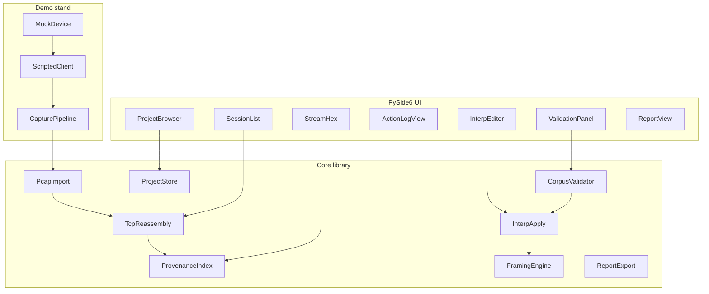

# Madrigal Protocol Laboratory

## Root README (to write on execute)

On execute: create [`README.md`](README.md) at repo root with the content below, and set `pyproject.toml` `readme = "README.md"`. Keep [`docs/RUN.md`](docs/RUN.md) as the detailed runbook.

### Proposed `README.md`

```markdown
# Madrigal
### Protocol Laboratory

> Research undocumented binary exchange over TCP — keep every conclusion
> tied to packets and bytes, and hand the project to another engineer without
> losing the trail.

Madrigal is a local desktop lab for reverse-engineering device protocols when
you have PCAP/PCAPNG and an action log, but no usable protocol spec. Open a
capture, align it with what the client did, frame messages, write an
interpretation, validate it on a corpus, and export a reproducible project.

Built for the **МАДРИГАЛ / Madrigal Protocol Laboratory** case: offline,
provenance-first, transferable research.

---

## The problem

TCP delivers a **byte stream**, not messages. A single application frame can
span packets; one packet can hold several frames. Retransmits and reordering
must not change the reconstructed payload. A value that appears after
“set 21” is only a **hypothesis** until it survives other parameters and
counterexamples.

Madrigal keeps those distinctions visible:

| Concept | Meaning |
|---------|---------|
| Observation | What appears in bytes / logs |
| Rule result | What the interpretation extracts |
| Hypothesis | Claimed meaning — still under test |
| Counterexample | Concrete data where a rule fails |

---

## What you can do

1. **Import** PCAP / PCAPNG (Ethernet + TCP/IPv4), pick a session and direction  
2. **Reassemble** directed streams with sequence order, retransmit dedupe, and explicit `UNKNOWN` / `AMBIGUOUS` spans  
3. **Navigate** from any derived result back to source packets and stream offsets  
4. **Align** traffic with an action log (read / set / measure)  
5. **Probe** framing — magic bytes, length prefixes, histograms  
6. **Author** interpretations — declarative YAML by default, optional Python for hard cases  
7. **Validate** on a corpus — contradictions, gaps, stale runs after edits  
8. **Ship** a portable project + human report + machine-readable apply path  

---

## Stack

| Layer | Choice |
|-------|--------|
| UI | PySide6 + hex stream viewer |
| Captures | TShark / PyShark (+ classic PCAP parser for demo files) |
| Analysis | pandas |
| Interpretations | YAML schema + optional Python hooks |
| Demo stand | Docker mock device + scripted client |
| Reuse | `madrigal-cli` headless apply / validate / report |

No Tkinter. No cloud. Main scenario is **offline**.

---

## Quick start

```bash
python3.11 -m venv .venv
source .venv/bin/activate
pip install -r requirements.txt
pip install -e ".[dev]"

# optional: TShark for PCAPNG
# macOS: brew install wireshark

madrigal-demo-corpus          # synthetic PCAPs + action logs
madrigal                      # GUI
madrigal-cli --help           # headless tools
pytest -q
```

Generate a research corpus without hardware:

```bash
madrigal-demo-corpus
# → madrigal/demo/corpus/main.pcap, action_log.json, extra.pcap, …
```

Or bring up the mock device stand:

```bash
cd madrigal/demo && docker compose up --build
```

Detailed steps: [docs/RUN.md](docs/RUN.md)

---

## Research loop

```text
  PCAP + action log
        │
        ▼
  session / directed stream ──► hex + packets (provenance)
        │
        ▼
  framing hypotheses ──► YAML / Python interpretation
        │
        ▼
  corpus validate ──► refine on counterexamples
        │
        ▼
  portable project + report + `madrigal-cli apply`
```

Hand the project folder (or zip) to another machine: relative paths only,
sources immutable, stale validation marked when rules change.

---

## Project layout

```text
madrigal/
  app/           PySide6 UI
  core/          PCAP, TCP, provenance, interp, validate, project, report
  cli/           Headless apply / validate / report
  demo/          Mock device, client, corpus generators
docs/            Case brief, runbook, plan
tests/
```

Portable research project (example):

```text
project.madrigal.json
captures/
action_logs/
interpretations/
observations/
validations/
settings.json
```

---

## Requirements coverage (case R1–R6)

| ID | Capability |
|----|------------|
| R1 | Source exchange, TCP reassembly, provenance navigation |
| R2 | Action alignment, compare, framing aids |
| R3 | Declarative + Python interpretations, programmable apply |
| R4 | Corpus validation, contradictions, stale results |
| R5 | Portable project, no absolute paths |
| R6 | Markdown report, machine-readable interp, CLI reuse |

Out of scope (per brief): live capture UI, TLS decryption, compression
codecs, full state-machine recovery.

---

## License / case

Course / lab case: **Лаборатория протоколов МАДРИГАЛ** — research and
description of unknown network protocols. See
[docs/Мадригал. Лаборатория протоколов.pdf](docs/Мадригал.%20Лаборатория%20протоколов.pdf).
```

## Decisions locked

- **UI:** PySide6 desktop only (no Tkinter, no web UI). Hex pane: try `QHexView` binding; fall back to a custom `QAbstractScrollArea` hex viewer if packaging is painful.
- **Interpretations:** declarative YAML/JSON as the default authoring path; optional sandboxed Python scripts for advanced framing/fields. Both share one apply engine and provenance model.
- **Demo data:** Docker mock TCP device + scripted client that produces PCAP/PCAPNG, action log, and a second “extra” capture for generalization tests; also defect captures (reorder/retransmit/gap).

## Architecture



**Provenance rule (non-negotiable):** every derived byte range, message, observation, and validation hit stores `(capture_id, session_id, direction, stream_offset, length)` plus optional packet IDs. Changing framing or interpretation never mutates source captures; stale validation results are marked when interpretation/settings hash changes.

## Repo layout (greenfield)

```
madrigal/
  app/                 # PySide6 entry + windows/panels
  core/
    pcap/              # import, session index
    tcp/               # reassembly, ambiguity policies
    provenance/        # byte↔packet maps
    interp/            # schema + python apply
    validate/          # corpus runner, counters
    project/           # portable .madrigal project
    report/            # markdown + machine JSON
  cli/                 # headless apply/validate for R6 reuse
  demo/
    device/            # Docker mock binary protocol server
    client/            # scripted actions
    corpus/            # generated pcaps, action log, defects
docs/
  ARCHITECTURE.md
  RUN.md
  APPROACH.md
tests/
```

## Core capabilities mapped to R1–R6

### R1 — Source exchange
- Import PCAP/PCAPNG via **PyShark/TShark** (primary) with explicit Ethernet/TCP/IPv4 checks; diagnose unsupported L2/IPv6.
- Build session list (5-tuple + connection instance; do not merge port reuse).
- Directed stream reassembly per RFC 9293: sequence order, identical retransmit dedupe, gap/truncation → `UNKNOWN` spans (never zero-fill), overlapping conflicts → `AMBIGUOUS` with chosen policy recorded in project settings (default: first-seen wins, ambiguity flagged).
- Hex/stream view + packet list with bidirectional navigation via provenance index.
- Checksum policy: configurable ignore/warn (document offloading).

### R2 — Investigation UI
- Action log panel (CSV/JSON from demo) time-aligned to capture timestamps.
- Session/stream browser, multi-example compare (diff two stream ranges or messages).
- Framing aids: length-prefix probes, fixed magic search, pandas-backed histograms of candidate delimiters.
- Search by time window linked to an action.

### R3 — Interpretations (declarative + Python)
**Declarative schema (default)** example shape:

```yaml
id: device_v1
scope: { protocol: demo-device, versions: ["1"] }
framing:
  type: length_prefixed
  header: { magic: "0xMD01", len_offset: 4, len_size: 2, len_includes_header: false }
messages:
  - when: { field: opcode, eq: 0x01 }
    fields:
      - { name: opcode, offset: 0, type: u8 }
      - { name: param, offset: 2, type: u16le, hypothesis: "setpoint" }
unknown_policy: leave_unparsed
```

**Python script (advanced):** `def frame(stream) -> list[Span]`; `def parse(message) -> dict` with access to declared helpers only; run in restricted subprocess/timeout; results still provenance-linked.

UI separates **rule-derived values** vs **hypotheses** (status: observation / rule / hypothesis / unverified).

### R4 — Corpus validation
- Select captures/sessions as corpus; apply interpretation; summary counts: ok / contradict / uncovered / unknown / ambiguous / inapplicable.
- Drill-down to bytes; filters visible in UI and stored.
- Re-run after edit; previous run marked stale if interpretation content hash ≠ stored hash.

### R5 — Portable project
- Project directory (zippable) with relative paths only:

```
project.madrigal.json
captures/*.pcapng
action_logs/*.json
interpretations/*.yaml|*.py
observations/*.json
validations/*.json
settings.json
```

- Open after directory move without absolute paths; dependency note in `RUN.md` + optional `requirements.lock`.

### R6 — Report and reuse
- Export Markdown report: rationale, examples, scope, counterexamples, open questions.
- Export machine-readable interpretation JSON + `madrigal apply --project ... --pcap extra.pcapng`.
- Bundle sample inputs/expected outputs under `demo/corpus/golden/`.

## Demo stand (2B)

Fake protocol (unencrypted binary over TCP):
- Framing: magic + length + opcode + payload
- Opcodes: read param, set param (u16), measurement response (variable payload up to 64 KiB)
- Docker Compose: `device` service + `client` that runs scripted action log while `tcpdump`/`tshark` writes PCAPNG
- Generate: main corpus, extra capture (different params), defect set (reorder via tc/netem or offline packet mutation)

This satisfies evaluation without real hardware and proves generalization (not filename lookup).

## Stack

| Layer | Choice |
|-------|--------|
| GUI | PySide6 + custom/QHexView hex |
| Capture I/O | PyShark / TShark |
| Analysis tables | pandas |
| Packaging/repro | Docker (demo) + `requirements.txt` / venv for app |
| Headless reuse | Click/argparse CLI |

## Phased delivery

### Phase 0 — Skeleton
Project package, PySide6 shell, Docker demo protocol + first PCAP + action log, empty project open/save.

### Phase 1 — R1 foundation
Import, sessions, reassembly, provenance, hex+packet navigation, defect diagnostics.

### Phase 2 — R2 investigation
Action-log alignment, search/compare, framing probes, pandas helpers in UI.

### Phase 3 — R3/R4 interpretations
Declarative engine + Python hook, editor, corpus validator, stale-result handling.

### Phase 4 — R5/R6 + NFRs
Portable projects, report/CLI apply, progress/cancel workers, resource limits & measurement script against 100 MiB / 250k pkt profile (synthetic stress capture), docs (`APPROACH`, `ARCHITECTURE`, `RUN`), golden reuse tests.

## Key implementation notes

- Long ops on `QThread`/`QObject` workers with progress + cancel; UI stays browsable.
- Never rewrite capture files; copies live under project `captures/`.
- One session error isolated; others remain usable.
- Tests: unit tests for reassembly edge cases; integration test: apply interpretation to extra capture; CLI golden test.

## Out of scope (per brief; not planned)
Live capture UI, TLS decryption, compression codecs, full state-machine recovery, IPv6/non-Ethernet (diagnose only).
